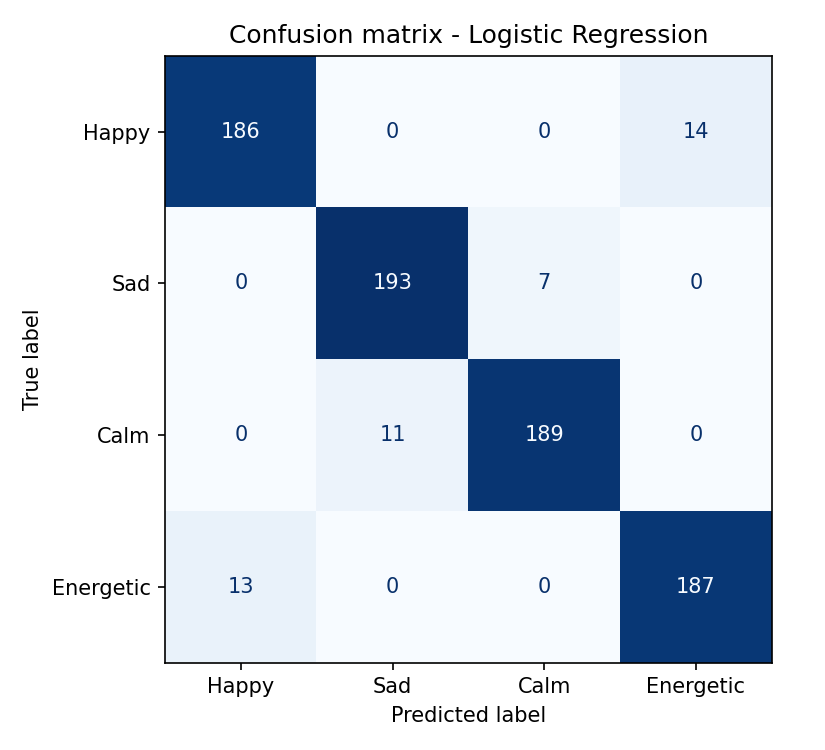

# 🎧 Music Mood Recommender

A machine-learning system that **predicts the mood of a song from its audio features** and recommends playlists for how you feel. Includes a CLI, a Streamlit web app and tests.

> **Idea:** Spotify-style audio features (valence, energy, danceability, ...) encode emotion. A classifier learns the mapping to four moods — *Happy, Sad, Calm, Energetic* — and a recommender ranks songs by mood confidence. A second, content-based engine finds songs with a similar audio profile.

## Features

- **Mood classification** — compares Logistic Regression, Random Forest and Gradient Boosting using 5-fold stratified CV (macro-F1) and keeps the best
- **Mood-based recommendations** — ranked by predicted probability, with genre filter and artist diversity (max 2 songs per artist)
- **Natural language input** — type *"feeling low and lonely tonight"* and the system detects the mood
- **Similar-song search** — cosine similarity on standardised audio features
- **Evaluation artefacts** — metrics JSON, confusion matrix and feature-importance plots in `reports/`
- **CLI + Streamlit app + pytest suite**

## Project structure

```
music-mood-recommender/
├── app.py                  # Streamlit app
├── src/
│   ├── config.py           # paths, feature list, moods
│   ├── generate_data.py    # synthetic song catalogue (Spotify-style features)
│   ├── train.py            # model comparison, evaluation, saving
│   ├── recommender.py      # MoodRecommender class (mood, text, similarity)
│   └── cli.py              # command-line interface
├── tests/test_recommender.py
├── data/  models/  reports/
└── requirements.txt
```

## Quick start

```bash
git clone https://github.com/<your-username>/music-mood-recommender.git
cd music-mood-recommender
python -m venv .venv && source .venv/bin/activate      # Windows: .venv\Scripts\activate
pip install -r requirements.txt

python -m src.generate_data     # creates data/songs.csv (4,000 songs)
python -m src.train             # trains + saves models/mood_classifier.joblib
streamlit run app.py            # web app
pytest                          # tests
```

### CLI examples

```bash
python -m src.cli --mood happy -n 5
python -m src.cli --text "need to relax and study" --genre Lo-Fi
python -m src.cli --similar-to "Golden Skies"
```

## Using a real dataset

Download a Spotify tracks CSV (e.g. the Kaggle *Spotify Tracks Dataset*), then rename columns to
`track_id, title, artist, genre, danceability, energy, valence, acousticness, instrumentalness, speechiness, liveness, tempo, loudness`
and save it as `data/songs.csv`. If it has no `mood` column, create one with
`label_mood_from_valence_energy` (in `src/generate_data.py`, based on the valence–energy model of emotion), then run `python -m src.train`.

## Results (bundled synthetic data, seed 42)

| Model | CV macro-F1 |
|---|---|
| **Logistic Regression** (selected) | **0.937** |
| Random Forest | 0.930 |
| Gradient Boosting | 0.929 |

Hold-out test accuracy: **~0.94** across the four moods. See `reports/confusion_matrix.png`.

> ⚠️ Moods in the synthetic data are generated from per-mood feature distributions with deliberate overlap, so this score shows the pipeline works — it is not a claim about real-world music. On real, human-labelled data expect lower scores and a bigger gap between models.

## How it works

1. **Features:** 9 audio descriptors (danceability, energy, valence, acousticness, instrumentalness, speechiness, liveness, tempo, loudness)
2. **Model:** `StandardScaler` → classifier pipeline, selected by cross-validated macro-F1
3. **Recommend:** score every song with `predict_proba`, rank by the requested mood's probability, enforce artist diversity
4. **Similar songs:** cosine similarity between standardised feature vectors

## Visuals



## Tech stack

Python · pandas · NumPy · scikit-learn · Matplotlib · joblib · Streamlit · pytest

## Possible extensions

- Add user listening history for hybrid (collaborative + content) recommendations
- Fine-tune on lyrics sentiment in addition to audio features
- Connect to the Spotify Web API to build real playlists
- Add a regression model for continuous valence/arousal

## License

MIT
